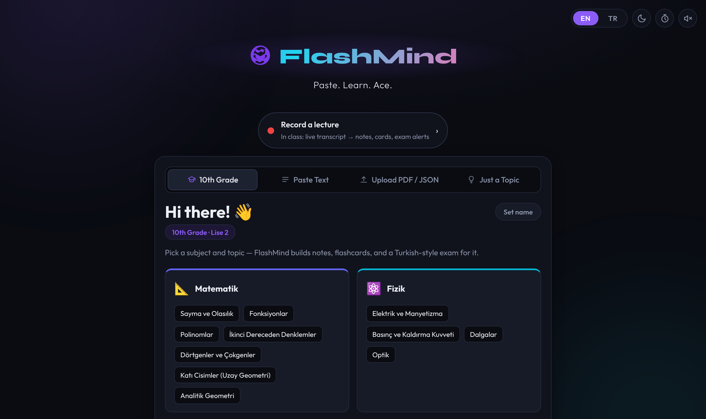
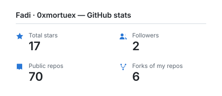
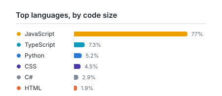

<div align="center">

<a href="https://0xmortuex.github.io">
  
</a>

<br/>

[**λ Mort**](https://github.com/0xmortuex/Mort) &nbsp;·&nbsp; [**💾 MORT OS**](https://github.com/0xmortuex/MortOS) &nbsp;·&nbsp; [**🤖 OSdev MCP**](#-ai-agents-that-do-os-development) &nbsp;·&nbsp; [**🧰 Dev MCP**](#-mcp-servers-for-everyday-dev-work) &nbsp;·&nbsp; [**⬇ Vex**](https://0xmortuex.github.io/vex-website/) &nbsp;·&nbsp; [**⚡ FlashMind**](https://0xmortuex.github.io/FlashMind/) &nbsp;·&nbsp; [**📚 Guides**](#-build-it-yourself--the-hard-way-guides)

<br/>



</div>

## 🆕 What's new

| | |
|---|---|
| 🧰 **30 new MCP servers** | Everyday dev tools for AI agents — test runner, import-graph impact analysis, secret scanning, linters for GitHub Actions, Kubernetes, Dockerfiles, Terraform plans and OpenAPI, plus safe tools for spreadsheets, PDFs, archives and media. [See them ↓](#-mcp-servers-for-everyday-dev-work) |
| 📚 **A "hard way" guide for every one** | Each new server ships with a companion guide that rebuilds it from an empty file — 38 guides in total |
| λ **[vex-lang](https://github.com/0xmortuex/vex-lang)** | My second language: type inference, enums with exhaustive `match`, `Option`/`Result` with `?`, generics, and its own bytecode VM |
| 🤖 **13 OSdev MCP servers** | Agents boot kernels in QEMU, rewind them, single-step over the gdbstub, and decode ACPI, devicetrees, page tables and linker maps — [jump to them ↓](#-ai-agents-that-do-os-development) |
| 💾 **MORT OS grew up** | Users, permissions and `sudo`, a hierarchical **MortFS v2**, a home launcher and Settings app, a power menu with lock / sleep / restart / shutdown, and a live RTC clock |
| 🌐 **Vex profiles & import** | Side-by-side profiles with their own tabs, passwords and sync, plus importing from Chrome, Edge, Brave and Firefox |
| ⚡ **FlashMind lecture mode** | Record a lecture in class and get a live transcript turned into notes, cards and exam alerts |
| 📰 **[ai-news-tracker](https://github.com/0xmortuex/ai-news-tracker)** | Rebuilt as a serverless pipeline: a scheduled Action ingests ~75 sources, dedupes and clusters stories, and publishes JSON + Atom feeds that the Vex start page reads |

<br/>

## λ The Mort stack — a language, then an OS written in it

I wanted to know what's *underneath*, so I built **[Mort](https://github.com/0xmortuex/Mort)** — a statically-typed language whose whole compiler (lexer, parser, type checker, C code generator) is written from scratch in Python with **zero libraries**. Then I wrote **[MORT OS](https://github.com/0xmortuex/MortOS)** in it. Mort compiles to C instead of being interpreted for one reason: **an interpreter can't boot.**

[](https://github.com/0xmortuex/Mort/actions/workflows/ci.yml)




<table>
<tr>
<td width="50%" valign="top">

**What MORT OS does today**

- **Boots real PCs** — Limine BIOS/UEFI ISO, straight from a USB stick
- **Real drivers** — PS/2 keyboard, PIT, CMOS clock, ATA disk, framebuffer, RTL8139 NIC
- **A real filesystem** — MortFS v2 with directories, owners and Unix permission bits
- **Users & `sudo`** — plus a shell with a working directory, `$PATH` and env vars
- **A desktop** — Terminal, Files, a Vex-styled browser and Settings, on `F1`–`F5`
- **Programs** — compiled Mort binaries talk to the kernel over `int 0x80`
- **Networking** — `net` gets an IP over DHCP, `httpd` serves a web page

</td>
<td width="50%" valign="top">

```rust
// examples/fib.mx
fn fib(n: int) -> int {
    if n < 2 { return n; }
    return fib(n - 1) + fib(n - 2);
}

fn main() -> int {
    let i = 0;
    while i < 10 {
        print(fib(i));
        i = i + 1;
    }
    return 0;
}
```

</td>
</tr>
</table>

<div align="center">

<a href="https://github.com/0xmortuex/MortOS"></a>

<a href="https://github.com/0xmortuex/MortOS#session--power"></a>
<a href="https://github.com/0xmortuex/mortnet"></a>

<sub>The desktop, the power menu, and <code>httpd</code> serving a page — a web server, on an OS, over a TCP/IP stack, every layer in one language I wrote.</sub>

</div>

**Around the OS — and a second language**

| Project | What it is |
|---|---|
| [**mortnet**](https://github.com/0xmortuex/mortnet) | TCP/IP stack written from scratch in Mort — NIC driver → ARP → IPv4 → ICMP → UDP → DHCP → DNS → TCP → HTTP — vendored into MORT OS |
| [**MortHardware**](https://github.com/0xmortuex/MortHardware) | Reusable bare-metal drivers pulled out of MORT OS: PCI, RTL8139, AC'97 audio, UHCI USB |
| [**mort-repo**](https://github.com/0xmortuex/mort-repo) | Package registry for `mpkg`, the MORT OS package manager |
| [**vex-lang**](https://github.com/0xmortuex/vex-lang) | Language #2 — type inference, enums and exhaustive `match`, `Option`/`Result` with `?`, generics, compiled to its own bytecode VM |
| [**nanomort**](https://github.com/0xmortuex/nanomort) | The whole idea in one Python file under 800 lines — a typed language that compiles to C and still boots a kernel |

<br/>

## 🤖 AI agents that do OS development

AI agents can edit and build a kernel, but they can't *see* it boot — and they make up hardware facts. These MCP servers close that gap. Every one works **below the OS**: no SSH, no guest agent, nothing installed in the guest. They grew out of my own MORT OS dev loop.

<div align="center">

</div>

<table>
<tr>
<td width="55%" valign="top">

| Server | It lets an agent… |
|---|---|
| [**qemu-mcp**](https://github.com/0xmortuex/qemu-mcp) ⭐ | boot an ISO or kernel, type, screenshot, read serial |
| [**qemu-replay-mcp**](https://github.com/0xmortuex/qemu-replay-mcp) | record a run, step *backwards*, find who wrote an address |
| [**gdbstub-mcp**](https://github.com/0xmortuex/gdbstub-mcp) | set breakpoints, read registers and backtraces — no gdb binary |
| [**uefi-mcp**](https://github.com/0xmortuex/uefi-mcp) | boot an `.efi` under OVMF and decode `EFI_STATUS` and GUIDs |
| [**acpi-mcp**](https://github.com/0xmortuex/acpi-mcp) | read MADT, FADT, MCFG from a live VM |
| [**devicetree-mcp**](https://github.com/0xmortuex/devicetree-mcp) | decode and validate `.dtb` / `.dts`, memory maps, IRQ routing |
| [**pagetable-mcp**](https://github.com/0xmortuex/pagetable-mcp) | walk live x86 page tables and explain page faults |
| [**linkmap-mcp**](https://github.com/0xmortuex/linkmap-mcp) | explain where code landed in a linked binary and why |
| [**x86-ref-mcp**](https://github.com/0xmortuex/x86-ref-mcp) | look up instruction forms, flags, CPUID, CR/MSR bits |
| [**kconfig-mcp**](https://github.com/0xmortuex/kconfig-mcp) | answer "why can't I enable `CONFIG_X`?" with `file:line` |
| [**syzbot-mcp**](https://github.com/0xmortuex/syzbot-mcp) | fetch and explain syzbot Linux kernel bug reports |
| [**osdev-wiki-mcp**](https://github.com/0xmortuex/osdev-wiki-mcp) | search the OSDev wiki offline |
| [**mort-mcp**](https://github.com/0xmortuex/mort-mcp) | write, type-check and run Mort — a language it has never seen |

</td>
<td width="45%" valign="top">

<a href="https://github.com/0xmortuex/qemu-mcp"></a>

<sub>An AI agent took this screenshot. It booted MORT OS headless, pressed <code>Esc</code>, typed <code>help</code>, and captured the framebuffer through <b>qemu-mcp</b> — four tool calls.</sub>

<br/><br/>

**Also for agents**

[**claude-code-skills**](https://github.com/0xmortuex/claude-code-skills) — 46 Claude Code skills for the unglamorous work that ships software. Before I add a skill, I check the existing ecosystem and only keep it if no well-known skill already does the job.

[**ClaudeCode-Brain**](https://github.com/0xmortuex/ClaudeCode-Brain) — turns local Claude Code history into a searchable, backlinked Obsidian vault.

</td>
</tr>
</table>

<br/>

## 🧰 MCP servers for everyday dev work

30 more servers for the jobs an AI assistant usually fumbles. They work offline, and they either only read or show a dry run before changing anything. Secrets are redacted by default.

<div align="center">

</div>

<details>
<summary><b>What each one does</b> — 30 servers</summary>
<br/>

**Code & repo**

| Server | It answers… |
|---|---|
| [**impact-mcp**](https://github.com/0xmortuex/impact-mcp) | What breaks if I change this file? Dependents, affected tests, cycles (Python, JS/TS) |
| [**testrun-mcp**](https://github.com/0xmortuex/testrun-mcp) | Run pytest, unittest, jest or vitest and get small structured failures, flaky detection, rerun-failed |
| [**stacktrace-mcp**](https://github.com/0xmortuex/stacktrace-mcp) | A root-cause report from a crash in Python, Node, Java, Go, Rust or .NET |
| [**gitrisk-mcp**](https://github.com/0xmortuex/gitrisk-mcp) | Hotspots, who knows this code, change coupling, bus factor |
| [**debt-mcp**](https://github.com/0xmortuex/debt-mcp) | Every TODO/FIXME with its real age and author from git blame |
| [**secretscan-mcp**](https://github.com/0xmortuex/secretscan-mcp) | Committed secrets in the tree and in git history, with rotation checklists |
| [**depaudit-mcp**](https://github.com/0xmortuex/depaudit-mcp) | Known vulnerabilities in your lockfiles, transitive deps included, via OSV.dev |
| [**license-mcp**](https://github.com/0xmortuex/license-mcp) | What licenses are my dependencies under, and can I ship this? |
| [**envdoctor-mcp**](https://github.com/0xmortuex/envdoctor-mcp) | `.env` vs `.env.example`, undocumented and unused variables across 11 languages |
| [**regexlab-mcp**](https://github.com/0xmortuex/regexlab-mcp) | Test a regex in real engines side by side, with ReDoS confirmed by timing |
| [**structdiff-mcp**](https://github.com/0xmortuex/structdiff-mcp) | Semantic diffs of JSON, YAML, TOML, CSV, `.env` and INI, with RFC 6902 patches |

**Infra & CI**

| Server | It answers… |
|---|---|
| [**workflowlint-mcp**](https://github.com/0xmortuex/workflowlint-mcp) | GitHub Actions audit: pwn requests, script injection, unpinned actions, token permissions |
| [**kubelint-mcp**](https://github.com/0xmortuex/kubelint-mcp) | 76 rules for Kubernetes manifests, no cluster or kubectl needed |
| [**dockerlint-mcp**](https://github.com/0xmortuex/dockerlint-mcp) | 47 rules for Dockerfiles and compose files, layer-cache analysis |
| [**tfplan-mcp**](https://github.com/0xmortuex/tfplan-mcp) | Risk-ranked review of a Terraform/OpenTofu plan: destroys, open firewalls, IAM broadening |
| [**oaslint-mcp**](https://github.com/0xmortuex/oaslint-mcp) | OpenAPI lint and breaking changes between Swagger 2.0, 3.0 and 3.1 |
| [**netcheck-mcp**](https://github.com/0xmortuex/netcheck-mcp) | Is my site healthy? TLS, DNS, headers, SPF/DMARC — with its own DNS resolver |
| [**har-mcp**](https://github.com/0xmortuex/har-mcp) | Slowest requests, failures and the critical path in a browser HAR trace |
| [**logs-mcp**](https://github.com/0xmortuex/logs-mcp) | Huge log files in constant memory: error clusters, timelines, request tracing |
| [**ports-mcp**](https://github.com/0xmortuex/ports-mcp) | What is using this port? Free it with a two-step confirmed kill |

**Files & media**

| Server | It does… |
|---|---|
| [**sheet-mcp**](https://github.com/0xmortuex/sheet-mcp) | Read and edit `.xlsx` without destroying formulas, charts or macros |
| [**sqlscope-mcp**](https://github.com/0xmortuex/sqlscope-mcp) | Explore an SQLite database, read-only by construction |
| [**duckdb-mcp**](https://github.com/0xmortuex/duckdb-mcp) | Sandboxed SQL over local CSV, Parquet and JSON |
| [**pdf-toolkit-mcp**](https://github.com/0xmortuex/pdf-toolkit-mcp) | Read, search, extract tables, merge and split PDFs — pure Python |
| [**mdvault-mcp**](https://github.com/0xmortuex/mdvault-mcp) | Obsidian-style notes: BM25 search, backlinks, link-updating rename |
| [**icskit-mcp**](https://github.com/0xmortuex/icskit-mcp) | Local `.ics` calendars: agenda, free time, DST-correct recurrence |
| [**unpack-mcp**](https://github.com/0xmortuex/unpack-mcp) | Zip/tar inspection and extraction that blocks zip-slip and decompression bombs |
| [**subtitle-mcp**](https://github.com/0xmortuex/subtitle-mcp) | Resync, shift, convert and repair SRT/VTT subtitles |
| [**picture-mcp**](https://github.com/0xmortuex/picture-mcp) | Resize, convert, compress to a target size, strip GPS/EXIF |
| [**ffmpeg-mcp**](https://github.com/0xmortuex/ffmpeg-mcp) | Compress to a target size, trim, GIF, extract audio — on PyPI as `mediakit-mcp` |

</details>

<br/>

## 📚 Build it yourself — "the hard way" guides

38 tutorials where you start from an empty file and end up with something that really works. Every chapter is taken from code that runs, and every step is checked — the OS guides in real QEMU.

| Guide | You end up with |
|---|---|
| [**Write an OS in your own language**](https://github.com/0xmortuex/write-an-os-in-your-own-language) | A compiler in plain Python, then a kernel in your new language that boots, persists files, and serves a web page |
| [**TCP/IP stack the hard way**](https://github.com/0xmortuex/tcp-ip-stack-the-hard-way) | Ethernet frames up to an HTTP server, based on mortnet and checked by golden tests |
| [**Kernel gdbstub the hard way**](https://github.com/0xmortuex/kernel-gdbstub-the-hard-way) | A gdbstub inside your own kernel — UART, RSP framing, single-step, `int3` breakpoints |
| [**ACPI the hard way**](https://github.com/0xmortuex/acpi-the-hard-way) | RSDP, MADT, FADT, shutdown, PCIe ECAM and HPET, from scratch |
| [**MCP server the hard way**](https://github.com/0xmortuex/mcp-server-the-hard-way) | An MCP server that lets an AI debug a kernel, from raw RSP bytes to triple-fault diagnosis |
| [**qemu-mcp the hard way**](https://github.com/0xmortuex/qemu-mcp-the-hard-way) | qemu-mcp rebuilt module by module — QMP, screenshots, typing, serial, snapshots |
| [**Roblox anticheat the hard way**](https://github.com/0xmortuex/roblox-anticheat-the-hard-way) | A production-grade server-side anticheat, every line explained |
| [**vex-lang the hard way**](https://github.com/0xmortuex/vex-lang-the-hard-way) | A typed language with inference, a bytecode compiler and a VM |

<details>
<summary><b>…and one for every everyday MCP server</b> — 30 more guides</summary>
<br/>

Each one rebuilds its server from scratch: the file formats, the safety rules, the edge cases, and the tests.

[debt-mcp](https://github.com/0xmortuex/debt-mcp-the-hard-way) · [depaudit-mcp](https://github.com/0xmortuex/depaudit-mcp-the-hard-way) · [dockerlint-mcp](https://github.com/0xmortuex/dockerlint-mcp-the-hard-way) · [duckdb-mcp](https://github.com/0xmortuex/duckdb-mcp-the-hard-way) · [envdoctor-mcp](https://github.com/0xmortuex/envdoctor-mcp-the-hard-way) · [ffmpeg-mcp](https://github.com/0xmortuex/ffmpeg-mcp-the-hard-way) · [gitrisk-mcp](https://github.com/0xmortuex/gitrisk-mcp-the-hard-way) · [har-mcp](https://github.com/0xmortuex/har-mcp-the-hard-way) · [icskit-mcp](https://github.com/0xmortuex/icskit-mcp-the-hard-way) · [impact-mcp](https://github.com/0xmortuex/impact-mcp-the-hard-way) · [kubelint-mcp](https://github.com/0xmortuex/kubelint-mcp-the-hard-way) · [license-mcp](https://github.com/0xmortuex/license-mcp-the-hard-way) · [logs-mcp](https://github.com/0xmortuex/logs-mcp-the-hard-way) · [mdvault-mcp](https://github.com/0xmortuex/mdvault-mcp-the-hard-way) · [netcheck-mcp](https://github.com/0xmortuex/netcheck-mcp-the-hard-way) · [oaslint-mcp](https://github.com/0xmortuex/oaslint-mcp-the-hard-way) · [pdf-mcp](https://github.com/0xmortuex/pdf-mcp-the-hard-way) · [picture-mcp](https://github.com/0xmortuex/picture-mcp-the-hard-way) · [ports-mcp](https://github.com/0xmortuex/ports-mcp-the-hard-way) · [regexlab-mcp](https://github.com/0xmortuex/regexlab-mcp-the-hard-way) · [secretscan-mcp](https://github.com/0xmortuex/secretscan-mcp-the-hard-way) · [sheet-mcp](https://github.com/0xmortuex/sheet-mcp-the-hard-way) · [sqlscope-mcp](https://github.com/0xmortuex/sqlscope-mcp-the-hard-way) · [stacktrace-mcp](https://github.com/0xmortuex/stacktrace-mcp-the-hard-way) · [structdiff-mcp](https://github.com/0xmortuex/structdiff-mcp-the-hard-way) · [subtitle-mcp](https://github.com/0xmortuex/subtitle-mcp-the-hard-way) · [testrun-mcp](https://github.com/0xmortuex/testrun-mcp-the-hard-way) · [tfplan-mcp](https://github.com/0xmortuex/tfplan-mcp-the-hard-way) · [unpack-mcp](https://github.com/0xmortuex/unpack-mcp-the-hard-way) · [workflowlint-mcp](https://github.com/0xmortuex/workflowlint-mcp-the-hard-way)

</details>

<br/>

## 🧭 Apps I ship

<table>
<tr>
<td width="50%" valign="top">

### [Vex](https://github.com/0xmortuex/Vex) — a browser built for you

A Chromium desktop browser (castLabs Electron, so **Widevine DRM works**) with a **built-in AI agent** that can work on your tabs, ad & tracker blocking, one-click Tor, an encrypted password vault with 2FA autofill, sidebar apps, profiles, and a UI you can rearrange to the pixel.

[](https://github.com/0xmortuex/Vex/releases/latest)
[](https://github.com/0xmortuex/Vex/releases)

**[⬇ Download for Windows](https://0xmortuex.github.io/vex-website/)** · [Self-hosting](https://github.com/0xmortuex/Vex/blob/main/SELF_HOSTING.md)

<a href="https://0xmortuex.github.io/vex-website/"></a>

</td>
<td width="50%" valign="top">

### [FlashMind](https://github.com/0xmortuex/FlashMind) — the AI study engine I use for school

Paste notes, upload a PDF, snap a photo (OCR in English **and** Turkish), record a lecture, or just name a topic. FlashMind turns it into notes, a flashcard deck and a Turkish-style exam with AI-graded open questions. Reviews are scheduled by an **FSRS-4.5** algorithm I wrote myself. It's vanilla JS, with no framework.


**[⚡ Try FlashMind](https://0xmortuex.github.io/FlashMind/)** · [Source](https://github.com/0xmortuex/FlashMind)

<a href="https://0xmortuex.github.io/FlashMind/"></a>

</td>
</tr>
</table>

<br/>

## 🗂 More work

<details>
<summary><b>🔒 Security & OSINT</b> — 6 projects</summary>
<br/>

| Project | Description | Live |
|---|---|---|
| [**ReconX**](https://github.com/0xmortuex/ReconX) | Domain recon in the browser — DNS, WHOIS, SSL, headers, tech stack, subdomains | [Demo](https://0xmortuex.github.io/ReconX/) |
| [**PassCrack**](https://github.com/0xmortuex/PassCrack) | Password analyzer that simulates real attacks — crack times, patterns, entropy, 100% in-browser | [Demo](https://0xmortuex.github.io/PassCrack/) |
| [**NetMap**](https://github.com/0xmortuex/NetMap) | Visual traceroute — packets hop across an interactive world map | [Demo](https://0xmortuex.github.io/NetMap/) |
| [**CipherLab**](https://github.com/0xmortuex/CipherLab) | 13 ciphers and hashes, each with visual step-by-step breakdowns | [Demo](https://0xmortuex.github.io/CipherLab/) |
| [**CodeLens**](https://github.com/0xmortuex/CodeLens) | Paste code, get an AI security audit and a quality report card | [Demo](https://0xmortuex.github.io/CodeLens/) |
| [**ai-proxy**](https://github.com/0xmortuex/ai-proxy) | Cloudflare Worker that keeps AI API keys out of client code, with streaming passthrough | — |

</details>

<details>
<summary><b>🤖 AI tools</b> — 6 projects</summary>
<br/>

| Project | Description | Live |
|---|---|---|
| [**ai-news-tracker**](https://github.com/0xmortuex/ai-news-tracker) | Serverless AI news pipeline — ~75 sources, clustering, scoring, JSON + Atom feeds | — |
| [**LoopholeMap**](https://github.com/0xmortuex/LoopholeMap) | Paste a regulation, see its loopholes as a severity-ranked D3 graph | [Demo](https://0xmortuex.github.io/LoopholeMap/) |
| [**AIJudge**](https://github.com/0xmortuex/AIJudge) | Describe an argument, get a verdict with legal-style reasoning and shareable ruling cards | [Demo](https://0xmortuex.github.io/AIJudge/) |
| [**TermsTrap**](https://github.com/0xmortuex/TermsTrap) | Flags data selling, forced arbitration and auto-renewals in any Terms of Service | [Demo](https://0xmortuex.github.io/TermsTrap/) |
| [**DebateBot**](https://github.com/0xmortuex/DebateBot) | Strongest arguments on both sides, with evidence chains and fallacy detection | [Demo](https://0xmortuex.github.io/DebateBot/) |
| [**LexScope**](https://github.com/0xmortuex/LexScope) | Turns dense legislation into navigable sections with plain-English summaries | [Demo](https://0xmortuex.github.io/LexScope/) |

</details>

<details>
<summary><b>🛠 Apps, desktop & extensions</b> — 9 projects</summary>
<br/>

| Project | Description | Live |
|---|---|---|
| [**mortuexOS**](https://github.com/0xmortuex/0xmortuex.github.io) | My portfolio as a desktop OS in the browser — boot sequence, windows, terminal, 9 apps | [Demo](https://0xmortuex.github.io) |
| [**Nexus**](https://github.com/0xmortuex/Nexus) | Process Lasso-style Windows optimizer (WPF) — per-process rules, crash-safe Game Mode, undo for every tweak | — |
| [**RoSuite**](https://github.com/0xmortuex/RoSuite) | Free RoPro alternative for Chrome/Brave — server browser, player info, trade calculator | — |
| [**Zine**](https://github.com/0xmortuex/Zine) | Manga reader with a print-zine design language — React 19 + MangaDex | — |
| [**mun-tracker**](https://github.com/0xmortuex/mun-tracker) | Mobile-first tracker for 43 Model UN conferences in Turkey | [Demo](https://0xmortuex.github.io/mun-tracker/) |
| [**ChatRoom**](https://github.com/0xmortuex/ChatRoom) | Anonymous real-time chat rooms on a Cloudflare KV backend | [Demo](https://0xmortuex.github.io/ChatRoom/) |
| [**BillForge**](https://github.com/0xmortuex/BillForge) | CUSA legislative bill editor with auto-numbering and live preview | [Demo](https://0xmortuex.github.io/BillForge/) |
| [**MiniOS**](https://github.com/0xmortuex/MiniOS) | The browser-OS experiment that grew into mortuexOS | [Demo](https://0xmortuex.github.io/MiniOS/) |
| [**Vencord + plugins**](https://github.com/0xmortuex/Vencord) | My Vencord build: ChatExporter, MessageLoggerEnhanced, [InactivityTracker](https://github.com/0xmortuex/vencord-inactivitytracker), [QuickNotes](https://github.com/0xmortuex/vencord-quicknotes), [RoleMembers](https://github.com/0xmortuex/vencord-rolemembers) and more | — |

</details>

<details>
<summary><b>🎮 Fun & data</b> — 3 projects</summary>
<br/>

| Project | Description | Live |
|---|---|---|
| [**TypeRush**](https://github.com/0xmortuex/TypeRush) | Typing game with quotes, real code snippets, live WPM and achievements | [Demo](https://0xmortuex.github.io/TypeRush/) |
| [**GitPulse**](https://github.com/0xmortuex/GitPulse) | Any GitHub username → a visual developer profile | [Demo](https://0xmortuex.github.io/GitPulse/) |
| [**steamogames**](https://github.com/0xmortuex/steamogames) | Live Steam player stats — concurrent players, peaks and trends | — |

</details>

<br/>

## 🧰 Stack

<div align="center">


[](https://github.com/0xmortuex/vex-lang)


</div>

## 📊 Stats

<div align="center">

<picture>
  <source media="(prefers-color-scheme: dark)" srcset="https://raw.githubusercontent.com/0xmortuex/0xmortuex/main/generated/overview-dark.svg" />
  
</picture>
<picture>
  <source media="(prefers-color-scheme: dark)" srcset="https://raw.githubusercontent.com/0xmortuex/0xmortuex/main/generated/languages-dark.svg" />
  
</picture>

<br/><br/>

<picture>
  <source media="(prefers-color-scheme: dark)" srcset="https://raw.githubusercontent.com/0xmortuex/0xmortuex/output/github-contribution-grid-snake-dark.svg" />
  
</picture>

<sub>No third-party stats services on this page. The cards come from <a href=".github/workflows/stats.yml">a workflow in this repo</a>, and the banner and diagrams are hand-written SVGs.</sub>

</div>

## 💬 Say hi

<div align="center">


<a href="https://0xmortuex.github.io"></a>

<sub>Add <b>vesperhex</b> on Discord — happy to talk about compilers, kernels, MCP, or anything in this README.</sub>

</div>

---

<div align="center">

<sub>Every web project above is open source, and most are live on GitHub Pages. Not sure where to start? <a href="https://github.com/0xmortuex/MortOS"><b>Boot MORT OS</b></a> or <a href="https://0xmortuex.github.io/FlashMind/"><b>try FlashMind</b></a>.</sub>

</div>
